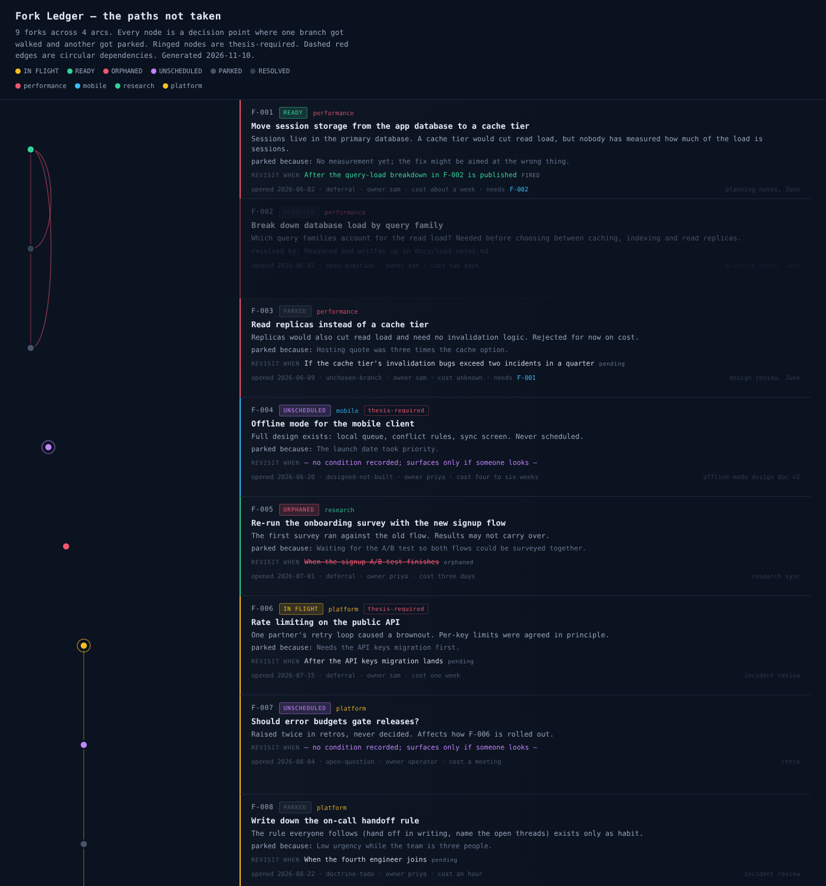

# Fork Ledger

A small command-line tool that records the work you decided **not** to do yet, and what would make it worth doing.

Every project forks. One branch gets walked and the others get parked, usually without anyone writing down that they were parked. Months later the parked idea is rediscovered from scratch, or a decision is made without the finding that would have changed it.

Fork Ledger is the record of those parked branches: deferrals, unchosen options, open questions, and things that were designed but never built. Each entry carries a **wake condition** in plain language, and the tool tells you which entries need attention now.

Two files, Python standard library only, one JSON ledger you can read and diff.

## The two cases it exists for

Most trackers can tell you what is blocked. Fork Ledger makes two quieter failure cases first-class:

- **Orphaned triggers.** Work parked behind a condition that can no longer happen ("after the A/B test finishes", and then the test is cancelled). Without a name for this state, orphaned work looks identical to work that is patiently waiting.
- **Unscheduled items.** Work with no wake condition at all. It will surface only if someone happens to look.

`wake` shows both, alongside triggers that have fired and work in flight.

## Sixty-second start

```bash
python3 fork_ledger.py init

python3 fork_ledger.py add \
  --title "Read replicas instead of a cache tier" \
  --kind unchosen-branch \
  --parked-because "Hosting quote was three times the cache option" \
  --trigger "If cache invalidation bugs exceed two incidents in a quarter"

python3 fork_ledger.py add --title "Should error budgets gate releases?" --kind open-question

python3 fork_ledger.py wake
```

The second entry has no trigger, so `wake` reports it as unscheduled until someone gives it one.

To explore without creating anything, point at the bundled example:

```bash
python3 fork_ledger.py --ledger examples/fork_ledger.example.json wake
```

```text
ACTIVE — in flight now:
  F-006  ***  [ACTIVE    ] Rate limiting on the public API

TRIGGER FIRED — the condition these were waiting on has happened:
! F-001   *   [OPEN      ] Move session storage from the app database to a cache tier
      trigger: After the query-load breakdown in F-002 is published

ORPHANED TRIGGER — waiting on something that can never happen:
x F-005   *   [OPEN      ] Re-run the onboarding survey with the new signup flow
      dead trigger: When the signup A/B test finishes

UNSCHEDULED — no wake condition; these surface only if someone looks:
  F-004  ***  [OPEN      ] Offline mode for the mobile client
  F-007   *   [OPEN      ] Should error budgets gate releases?
```

Requires Python 3.9 or newer (tested on 3.11 to 3.13). Nothing to install.

## Where a fork can stand

| State | Meaning | Shown by `wake` |
| --- | --- | --- |
| Parked | Waiting on a stated condition that has not happened | No |
| Fired | The condition happened; the wait is over | Yes |
| Orphaned | The condition can never happen | Yes |
| Unscheduled | No condition was ever recorded | Yes |
| Active | Being worked on now | Yes |
| Resolved | Closed or superseded, with a recorded reason | No |

When more than one applies, the most urgent wins: resolved, then fired or orphaned, then active, then unscheduled, then parked.

## Commands

| Command | What it does |
| --- | --- |
| `init` | Create an empty ledger. Refuses to overwrite. |
| `add` | Record a fork. `--title` and `--kind` are required. |
| `wake` | Print the actionable set. Read this first. |
| `list` | Filter by `--status`, `--trigger`, `--thesis`, `--kind`, `--owner`, `--arc`. |
| `show F-001` | Print one fork with its history. |
| `fire F-001 --note "..."` | Record that the wake condition happened. |
| `orphan F-001 --note "..."` | Record that the wake condition can no longer happen. |
| `park F-001 --trigger "..."` | Give a fork a new wake condition. |
| `start F-001` | Mark a fork as in flight. |
| `close F-001 --by "..."` | Close it. The reason is mandatory. Add `--superseded` to cite a successor. |
| `check` | Integrity check; exits 1 on problems. `--fix` repairs one known case (see below). |
| `report -o file.md` | Write a Markdown report grouped by state. |
| `priorwork <terms> --in <paths>` | Search the ledger and your documents before starting something new. |

The ledger file is chosen by `--ledger`, then the `FORK_LEDGER` environment variable, then `./fork_ledger.json`.

### Fields

`id`, `title`, `kind`, `arc`, `opened`, `source`, `summary`, `parked_because`, `trigger`, `trigger_status`, `status`, `thesis_dep`, `cost`, `owner`, `depends_on`, `refs`, and an appended `history`.

- **kind**: `deferral`, `unchosen-branch`, `designed-not-built`, `open-question`, `doctrine-todo` (a rule everyone follows that nobody has written down).
- **thesis_dep**: `REQUIRED`, `helpful` or `unrelated`. Does the thing your project exists to prove or deliver depend on this fork? Parked forks marked `REQUIRED` are the ones to worry about.
- **arc**: the line of work a fork belongs to. It becomes a lane in the graph.
- **depends_on**: other forks that have to happen first.

## Rules the tool enforces

- **Closing requires a reason.** `close` without `--by` is refused.
- **Nothing is deleted.** Forks are amended, closed or superseded. There is no remove command.
- **"None" is not a condition.** `--trigger none`, or `--trigger "none — nobody owns it"`, records the fork as unscheduled. `park` refuses a trigger of `none`.
- **Every state change is appended to the fork's history** with a date and your note.

The tool does **not** evaluate triggers. Deciding that a condition has happened, or can no longer happen, is a judgment for a person or an agent. The tool records the judgment and keeps it visible.

## When to read it

Three moments cover most of the value:

1. **Starting a planning session.** Run `wake`. What has become actionable?
2. **Finishing a piece of work.** What did finishing it trigger, and what did it orphan?
3. **Before starting something new.** Run `priorwork` with a few keywords. It costs seconds, and it is how you find out you already decided this once.

Add `check` to a pre-commit hook if the ledger lives in a repository.

## Using it with an AI coding agent

Long agent sessions lose deferred intentions for the same reason people do: "we'll come back to that" is said once and nothing brings it back. The ledger gives an agent somewhere to put the intention and a command that returns it.

Paste something like this into the instructions file your agent reads (`AGENTS.md`, `CLAUDE.md` or equivalent):

```markdown
## Deferred work

- At the start of a session, run `python3 fork_ledger.py wake` and tell me what is awake
  before we plan.
- Whenever we defer something, pick one option over another, or leave a question open,
  record it with `fork_ledger.py add`. Include `--parked-because` and a concrete
  `--trigger`. If there is no real trigger, omit it; do not invent one.
- When work finishes, check whether it fired or orphaned any trigger, and record that
  with `fire` or `orphan`. Ask me before you `close` anything.
- Before proposing new work, run `fork_ledger.py priorwork <keywords> --in docs/`.
```

This is a working practice, not a measured result. Whether a ledger like this improves an agent's score on prospective-memory benchmarks has not been tested here. See `docs/fork-ledger-writeup.md` for what is and is not established.

## The graph

```bash
python3 fork_graph.py --ledger examples/fork_ledger.example.json -o fork-graph.html
```

This writes one self-contained HTML page: a lane per arc, a node per fork in date order, curves for dependencies, and the revisit condition on every card. Circular dependencies are detected and called out at the top, because a cycle is a pair of forks that will each wait for the other forever.



Keep `fork_graph.py` next to `fork_ledger.py`. It imports the state rules from it so the graph and `wake` cannot disagree.

## Repairing an older ledger

Ledgers written by version 0.1 could store a fork with the trigger text `none` but mark it as pending, which hid it from `wake`. `check` reports these; `check --fix` reclassifies them as unscheduled and notes the change in each fork's history. Version 0.1 ledgers otherwise load unchanged.

## Tests

```bash
python3 -m unittest discover -s tests -v
```

## Limits

- One flat JSON file. Fine for hundreds of forks and one writer; not designed for concurrent editing or thousands of entries.
- Triggers are free text. Nothing checks them against the world.
- Dependencies are recorded and drawn, and cycles are detected, but nothing is scheduled from them.
- The tool makes parked work visible. It does not make anyone act on it.

## Background

`docs/fork-ledger-writeup.md` describes the idea, what its first weeks of use in one research program showed, and what has not been tested. If you build on the tool or the idea, that note is the reference to cite.

## License

Code: Apache License 2.0. See `LICENSE` and `NOTICE`.

The write-up in `docs/` is licensed under [CC BY 4.0](https://creativecommons.org/licenses/by/4.0/).

Copyright 2026 EngramForge, Inc.
